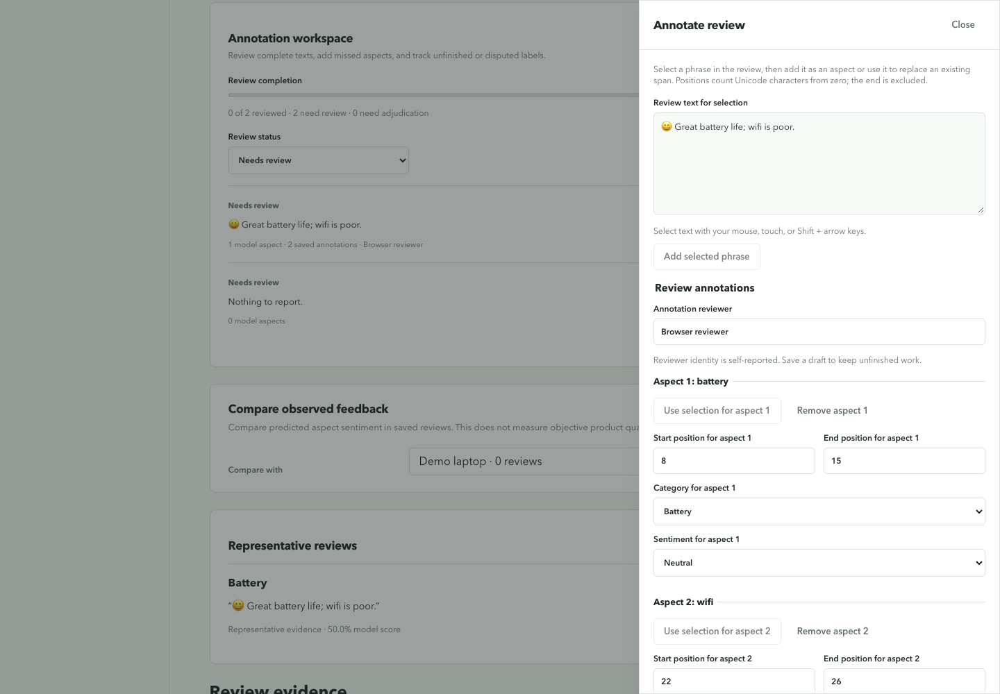

# Review Tag Generator

Turn product reviews into feature-level feedback you can inspect and review.

Two fine-tuned DistilBERT models extract aspect spans and classify their sentiment.
Deterministic rules normalize known aliases, generate tags, and aggregate saved
predictions into product insights. The application keeps original evidence,
reviewer corrections, and full-review annotations separately traceable.

[Getting started](docs/getting-started.md) · [Documentation](docs/README.md) ·
[Architecture](docs/architecture.md) · [Release status](docs/release-status.md)

The new [shopping companion guide](docs/shopping-companion.md) covers the saved-product
interface, feature/evidence view, comparison page, and unpacked local Chrome extension.
Open **Browser companion** in the app for setup. The retailer adapter is experimental;
selection/paste, unsaved preview, and explicit saving work through the local API.

## What you can do

| Workflow | What it provides |
|---|---|
| Preview and save | Highlighted aspects and sentiment before committing reviews to product totals |
| Product insights | Canonical feature counts, sentiment, supported tags, and representative evidence |
| Bulk imports | TXT, CSV, JSON, JSONL, and NDJSON validation with durable jobs and row-error export |
| Evidence tools | Review quality queue, single-review-removal robustness, and support-aware product comparison |
| Optional LLM assistance | Unknown-aspect suggestions and answers citing saved review excerpts |
| Reviewer corrections | Accept, edit, or reject suggestions; correct sentiment; retain decision history |
| Annotation workspace | Add missed aspects, edit boundaries, track review status, save drafts, and export annotations |
| Saved-data controls | Remove an imported batch, clear reviews, or delete a product |

The trained pipeline uses `full_review` sentiment context and verified checkpoints.
Missing model artifacts cause an explicit error. The optional heuristic demo is
selected deliberately and labeled in the UI. LLM calls run only on request.
Reviewer decisions and annotations do not automatically change model predictions,
product totals, ontology aliases, or model weights.

## Quick start

Prerequisites: Python **3.11**, Node.js **22** (the CI version), npm, and Git LFS.
The two trained checkpoints require approximately **508 MB** of downloads. Raw
training datasets are not required to run inference.

```bash
git lfs install
git clone https://github.com/sudo8phoenix/Review_tag_generator.git
cd Review_tag_generator
git lfs pull
python3.11 -m venv .venv
.venv/bin/python -m pip install -e '.[model,backend,test]'
PYTHONPATH=src .venv/bin/python scripts/verify_artifacts.py
npm --prefix frontend ci
./scripts/start_demo.sh
```

Open **[the app](http://127.0.0.1:5173)** and
[API documentation](http://127.0.0.1:8000/docs). Select **Demo laptop**, preview a
review, then choose **Save review**. Once processing finishes, open product
insights to examine evidence and annotations.

The launcher uses API port **8000** and frontend port **5173**. If port 8000 is
occupied, follow the [alternate-port instructions](docs/getting-started.md#alternate-api-port).
Local data persists in `.demo/application.sqlite3`.

To run an explicitly labeled rules-based demo instead:

```bash
DEMO_MODEL_BACKEND=heuristic ./scripts/start_demo.sh
```

This is a local demo without authentication. Keep it bound to localhost or a
trusted network. See [deployment boundaries](docs/getting-started.md#compose-deployment)
before exposing it publicly.

## Review and annotate

Open a saved review's highlighted aspect to accept, edit, or reject a mapping
suggestion, correct sentiment, or mark a phrase unsupported. The
**Annotation workspace** adds full-review worklists with **Needs review**,
**Reviewed**, and **Needs adjudication** filters. Reviewers can select missing
phrases, adjust exact spans, confirm reviews with no explicit aspects, and advance
to the next unfinished review.



*Actual UI with synthetic reviews and the explicit heuristic test backend. This
capture illustrates annotation controls, not measured prediction accuracy.*

Both workflows preserve original predictions and append review history. Names and
completion are self-reported in this local app; exports are not independently
adjudicated gold labels. Read [review corrections](docs/review-corrections.md) and
[full-review annotation](docs/review-annotations.md) for behavior and API details.

## Results and verification

| Measurement | Result | Scope |
|---|---:|---|
| Aspect extraction exact-span F1 | **70.62%** | Frozen test, 1,616 reviews |
| Sentiment Macro F1 | **74.96%** | Frozen test, 1,445 gold aspect–sentiment pairs |
| Local preview median | **566.45 ms** | Ten warm sequential requests on Apple M4; includes scheduling and polling |
| Python verification | **326 passed, 2 skipped** | Skips require a live PostgreSQL test database |
| Browser verification | **20 passed** | Isolated test app; provider responses injected where noted |
| Frontend unit verification | **5 passed** | Lint and production build also pass |

Component ML scores do not establish end-to-end tag accuracy. There is no approved
human-reviewed normalization or canonical-tag accuracy score. The latency sample
is a smoke measurement, not a production benchmark. PostgreSQL migration SQL
generates through **0005**, but live PostgreSQL and Linux container execution have
not been verified on this host. Remote CI status is separate from local checks.

See [performance evidence](docs/performance.md), [evaluation](docs/evaluation.md),
and [verification commands](docs/verification.md).

## Dataset preparation

The new annotation workset uses the
[Virtual Assistant Devices Dataset](https://data.mendeley.com/datasets/d5vsgcxrk5/1),
version 1, by Yaser alhasawi and Salem Algamdi, under the publisher's CC BY 4.0
license. Its 2,370 reviews provide review-level labels; exact spans, canonical
IDs, and per-mention sentiment still need annotation.

The local preparation audits duplicates and overlap with existing model splits,
then creates 100 development and 100 held-out tasks. Automated development
proposals retain their provenance and remain pending human review; held-out
inference has not been run. The raw workbook and review text remain outside Git.
See [dataset sources](docs/datasets.md) and [the workset guide](docs/annotation-workset.md).

## Deployment and library use

The Compose recipe runs PostgreSQL, migrations, API, a separate inference worker,
and the built frontend at `http://127.0.0.1:8080`. Follow the
[deployment instructions](docs/getting-started.md#compose-deployment), including
database credentials, Git LFS, migration head, and verification limitations.

For a small library demonstration:

```bash
.venv/bin/python scripts/run_demo.py
```

The library entry point is `ReviewAnalyzer`. Its `analyze(review)` returns
mention-level results; `aggregate(reviews)` is the legacy prototype adapter.
Persisted application snapshots use `aggregate_saved_analyses` with the
[saved-analysis aggregation policy](docs/contracts/aggregation.md).
`use_transformer="auto"` currently requires trained artifacts just like `True`;
choose `False` explicitly for heuristic library use.

## Repository map

```text
src/review_tag_generator/   Models, normalization, tags, and evidence tools
backend/app/               API, workers, persistence, corrections, annotations
backend/alembic/           PostgreSQL schema migrations
frontend/src/              React routes, review forms, and annotation workspace
frontend/e2e/              Browser workflow verification
scripts/                   Evaluation, dataset preparation, imports, and demos
tests/                     Unit, HTTP/storage, PostgreSQL, and model checks
audit/evidence/            Evaluation reports, manifests, and diagnostic summaries
docs/                      User guides, architecture, API reference, and evidence
```

For a guided presentation, use the [faculty demo](docs/faculty-demo.md),
[portfolio guide](docs/portfolio-guide.md), and
[labeled screenshot assets](docs/assets/portfolio/README.md).
Report bugs with reproduction steps and expected behavior through
[GitHub Issues](https://github.com/sudo8phoenix/Review_tag_generator/issues).

Dataset licenses apply to their named sources; they do not establish a license
for this repository's code. Check the source-specific terms before redistribution.
