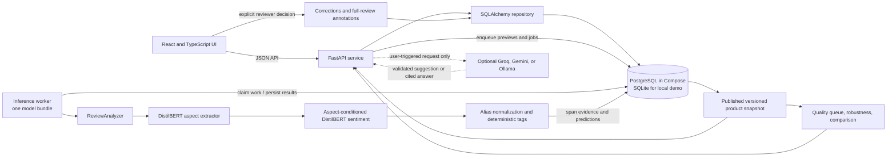

# System architecture

This document describes the application that exists in the repository. The
production-shaped Compose topology is provided, but this project has not been
established as a deployed public service. See [release status](release-status.md)
for verification limits and [the API contract](contracts/api-v1.md) for the
separately documented target contract.

## System map



The UI communicates with FastAPI. The API validates requests and coordinates
storage and work; the worker loads one `ReviewAnalyzer` and performs inference.
The local development mode can run the worker in the API process. Compose sets
`RUN_EMBEDDED_WORKER=0` and runs a separate worker service, so API startup does
not need to load the model bundle. Model artifacts are shared with both services
through the application image. No web-facing LLM call is part of normal review
analysis.

## Review and import lifecycle

```mermaid
sequenceDiagram
    participant UI as Browser
    participant API as FastAPI
    participant DB as Repository / SQL database
    participant W as Inference worker
    participant M as ReviewAnalyzer

    UI->>API: Preview review(s)
    API->>DB: Create expiring preview rows
    API-->>UI: Preview IDs
    W->>DB: Claim preview and lease it
    W->>M: Extract, classify, normalize
    M-->>W: Mention-level evidence
    W->>DB: Store temporary preview result
    UI->>API: Poll preview IDs
    API-->>UI: Show preview; totals unchanged
    UI->>API: Save review(s) or import file
    API->>DB: Validate, deduplicate, create durable job and items
    API-->>UI: Job ID and accepted/rejected counts
    W->>DB: Claim job / item with expiring lease
    W->>M: Analyze each accepted review
    M-->>W: Tags, offsets, scores, policy and backend
    W->>DB: Store immutable analysis and aspect mentions
    W->>DB: Publish aggregate snapshot when job completes
    UI->>API: Poll job and request product detail
    API->>DB: Read job state and selected snapshot
    API-->>UI: Progress, evidence, and snapshot-consistent totals
```

Preview rows are temporary, expire after 30 minutes, and never enter product
aggregation. Saving is a distinct action that creates a durable processing job.
The frontend polls job and preview IDs; saving a batch does not hold the HTTP
request open while models process its rows. A worker claims jobs and items using
database leases and heartbeats, and records row-level failures for inspection or
retry. Idempotency keys protect repeated submission requests when supplied.

Review duplicates are scoped to a product. Their key is created from
whitespace-normalized, case-folded text, while the original review text remains
the model input and evidence source. Database uniqueness constraints provide a
second guard against duplicate rows. File imports accept TXT, CSV, JSON, JSONL,
and NDJSON through the application parser; size and row limits are bounded.
Validation can be run before saving, and job errors can be downloaded as CSV.
The Amazon importer script adds restartable source-file batching for that dataset.

## Storage and consistency

SQLAlchemy maps the repository to PostgreSQL in the Compose topology and SQLite
for the local demo. Alembic migrations define the PostgreSQL schema. Core records
include products, reviews, immutable analysis runs, aspect mentions, processing
jobs and items, temporary previews, idempotency requests, worker heartbeats, and
product snapshots. Reviewer suggestions, append-only corrections, and full-review
annotation revisions are stored separately from model analyses. PostgreSQL JSONB is used for structured payloads where
available; SQLite stores the local equivalent as JSON.

Each saved review analysis records its pipeline version, backend, sentiment
context policy, input hash, elapsed inference time, result payload, and mention
details. A mention stores its original-text span and context offsets, raw and
canonical aspect, confidence components, sentiment probabilities, normalization
method, and deterministic tag. Confidence scores are not calibrated correctness
probabilities.

When a job produces analyses, the repository aggregates saved results and
publishes an immutable snapshot identified by product, pipeline version,
aggregation version, and data revision. Product detail reads the snapshot's
membership and evidence together. While new work is pending, the last published
snapshot remains visible and is marked stale where appropriate; the UI does not
combine in-progress rows with old totals. This is the consistency boundary for
product insights and downstream tools.

## Batch data controls

The UI/API include operations to list a product's saved imports, remove one
completed import, clear saved data while retaining the product, or delete the
saved product and its data. These operations check that the import belongs to
the requested product. Removal runs transactionally, clears dependent saved
evidence and references, and republishes an empty or updated snapshot as
appropriate. The repository rejects product-wide clear/delete and import removal
while active jobs or previews exist. This keeps deletion from racing with a
worker that is currently analyzing saved data.

These are destructive actions on the local demo database. The current app is a
single-user demo with no authentication or user/tenant ownership model; product
association is an application consistency check, not a multi-tenant security
boundary.

## Model and rule pipeline

The normal inference path in `src/review_tag_generator/pipeline.py` follows this
sequence:

1. The aspect extractor predicts BIO token labels from the original review and
   decodes aspect spans with Unicode code-point offsets. Long reviews use
   overlapping windows.
2. A separate DistilBERT classifier predicts negative, neutral, or positive
   sentiment conditioned on the aspect and its selected review context. The
   evaluated transformer policy is `full_review`; aspect-preserving cropping
   handles inputs over the model token budget.
3. Deterministic ontology aliases map known phrases to one of the canonical
   aspects. Unknown phrases remain inspectable and do not produce a canonical
   aggregate tag. Optional semantic normalization is off by default until a
   pinned model and reviewed threshold are supplied.
4. Rules generate repeatable tag text. Aggregation uses one vote per saved
   review-aspect pair, treats positive/negative contradiction within one review
   as a neutral vote, and requires three distinct review votes for a tag.

`DEMO_MODEL_BACKEND=heuristic` explicitly selects a separate rules-based demo
mode; it does not silently replace missing transformer artifacts. The interface
labels the mode. The evaluated metrics refer to the trained transformer path,
not the heuristic demo.

## Insights and assistance paths

The quality queue, evidence robustness report, and product comparison operate on
persisted predictions and published snapshots. They do not run inference or
change model labels. The robustness report simulates removal of a single saved
review-aspect vote. Product comparison reports directional differences only
when both products meet the minimum support and use compatible pipeline
versions. These tools describe observed predictions and evidence sensitivity,
not objective product quality or prediction correctness.

Optional LLM assistance is a side path activated by an explicit user request.
Unknown-aspect mapping suggestions are checked against original-text offsets and
the ontology. Product questions retrieve bounded excerpts from the current
published snapshot; returned citations are checked against source review IDs and
exact quotes. Preview suggestions and answers are ephemeral; suggestions for saved
evidence are persisted so reviewers can accept, edit, or reject them. These records
do not update the ontology, saved analyses, tags, or product totals. With a cloud provider configured,
requested text is sent to that provider. Local Ollama is also supported. See
[LLM setup and validation limits](llm-assistance.md).

## Reviewer lifecycle

[Aspect corrections](review-corrections.md) record mapping and sentiment decisions
against an exact saved span. [Full-review annotations](review-annotations.md) also
support missing aspects, changed boundaries, removed false positives, and explicit
no-aspect reviews. Both retain the original analysis and append revision history.

Annotation worklists include every analyzed review in the published snapshot,
including zero-detection reviews. A draft starts from saved predictions and any
aspect corrections, but completion requires an explicit reviewer action. Statuses
are `needs_review`, `reviewed`, and `needs_adjudication`. A later aspect correction
makes a previous completion effectively `needs_review` again.

UUID request IDs make retries idempotent; expected annotation/correction revisions
reject stale edits. Product locking serializes writes and export membership.
Exports preserve provenance and distinguish saved from effective status. Reviewer
names are self-reported: this demo has no authenticated identity or independent
gold-label certification. Decisions never feed automatically into aggregation or
training. Removing a source review also removes its suggestions, corrections,
and annotation history.

## Seed and migration behavior

The demo database gets its initial `Demo laptop` product once, protected by an
`application_settings.demo_seeded` marker and a deterministic product ID. A
separate one-time script can idempotently add a small fixed product catalog. The
legacy demo migration helper is read-only with respect to its source; it imports
through the application path so normal validation, duplicate handling, and job
semantics apply. These behaviors are local demonstration setup, not a deployed
customer onboarding or account system.

## Runtime topology and boundaries

The current Alembic head is `0005_review_annotations`; migrations 0004 and 0005
add the reviewer records.

The Compose file defines PostgreSQL, a one-time Alembic migration service, API,
one inference worker, and a built frontend. The frontend port is bound to
localhost. The checked-in configuration is a deployment recipe; this repository
does not establish that the stack is live or that a public deployment exists.
The release status notes that Docker and live PostgreSQL execution were not
available in the referenced local verification, and that the lock file records
a macOS ARM64 resolution. Remote CI results must be checked independently.

There is no authentication or authorization. Keep the demo bound to localhost
or a trusted network. It has no tenancy boundary, backup policy, monitoring
service, or operational SLO documented here. These constraints are part of the
current project scope and should be stated in portfolio material.

## Code map

| Concern | Main implementation |
|---|---|
| Model orchestration | `src/review_tag_generator/pipeline.py`, `transformer_models.py` |
| Span extraction and sentiment | `src/review_tag_generator/extraction.py`, `sentiment.py` |
| Normalization and tags | `src/review_tag_generator/normalization.py`, `ontology.py`, `tags.py` |
| Product aggregation | `src/review_tag_generator/aggregation.py` |
| HTTP API and request validation | `backend/app/main.py`, `imports.py` |
| Durable queue and snapshots | `backend/app/repository.py`, `worker.py`, `db/models.py` |
| Optional LLM path | `backend/app/llm_assistance.py`, `llm_provider.py` |
| Reviewer records | `backend/app/corrections.py`, `backend/app/annotations.py` |
| Offline annotation workset | `scripts/prepare_review_annotations.py` |
| Browser routes and workflow | `frontend/src/routes/`, `frontend/src/components/` |
| Model results and provenance | `audit/evidence/`, `docs/evaluation.md` |
