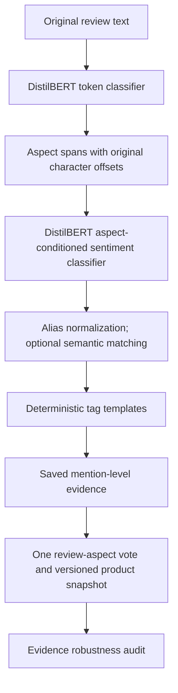

# How the machine learning works

This guide explains the implementation in this repository, what was trained,
what is deterministic application logic, and what the recorded results establish.
It can be used for a project report or viva preparation.

## 1. The problem: sentiment about individual product features

A single review can discuss several features with different opinions. A whole-review
positive/negative label loses that detail. This project uses aspect-based sentiment
analysis: find the feature being discussed, predict sentiment about it, map it to a
shared feature name, and produce a readable tag.

For “Amazing display but terrible battery”, the intended interpretation is a
positive display mention and a negative battery mention. This is an illustration
of the task, not a guarantee of the trained model's output. The selected full-review
sentiment policy has a known limitation on this type of contrastive sentence.

## 2. The complete pipeline

The worker runs the pipeline. Preview results are temporary and do not affect
product totals. Saved reviews are analyzed separately and committed with their
evidence. Neither submission nor preview trains or updates model weights.

The main entry point is [ReviewAnalyzer](../src/review_tag_generator/pipeline.py).
The trained model wrapper is [TransformerModels](../src/review_tag_generator/transformer_models.py).
The explicit heuristic demo is a separate rule-based mode, not another trained model.

## 3. Model one: finding aspect spans

The aspect extractor fine-tunes `distilbert-base-uncased` for token classification.
DistilBERT provides contextual representations: a token's representation depends
on the surrounding text. A classification head predicts a BIO label for each
model token:

| ID | Label | Meaning |
|---|---|---|
| 0 | O | Outside an aspect |
| 1 | B-ASP | Beginning of an aspect |
| 2 | I-ASP | Continuation of an aspect |

For example, the desired word-level labels for “Great battery life” are
`O B-ASP I-ASP`. The model tokenizer may split words into subword tokens; training
alignment and inference decoding connect these token labels to source spans.
The training and evaluation implementation is retained in
[the notebook](../distilbert_review_generator.ipynb).

Inference keeps the original text and tokenizer offsets. It uses overlapping
windows with a maximum model length of 256 and overlap of 64 tokens, rather than
silently reading only the beginning of a long review. The wrapper limits accepted
review tokens to 4,096. Window candidates are reconciled into source spans, so
repeated text and overlapping predictions can be handled without rewriting the
review. Returned offsets use Unicode code points and refer to the exact original
text; lowercased model input does not replace the stored review.

Aspect confidence summarizes token probabilities for the extracted span. A
plausible span with high confidence can still be wrong.

## 4. Model two: sentiment conditioned on an aspect

A separate DistilBERT checkpoint performs three-class sequence classification.
Its input is a pair: `(review context, aspect text)`. This lets the model condition
its sentiment prediction on the feature being asked about.

| ID | Sentiment |
|---|---|
| 0 | Negative |
| 1 | Neutral |
| 2 | Positive |

The classification head produces three logits. Softmax turns them into values
that sum to one; the largest selects the label and its value is reported as
sentiment confidence. These scores have not been calibrated to represent the
probability that a prediction is correct.

The selected trained policy is `full_review`. For input exceeding the token
budget, the wrapper uses aspect-preserving context cropping. It stores the actual
context offsets with the prediction. `local_clause` is an alternative context
policy, but it failed the required neutral-recall validation gate. The explicit
heuristic demo uses local clauses and is labeled separately.

The two models solve different tasks and use separate checkpoints. Sentiment is
not derived from the star rating. Extraction errors can feed incorrect or missing
aspects into sentiment classification, so good sentiment scores on gold aspects
do not establish the quality of the whole pipeline.

## 5. Training and policy selection

The saved training manifests record the following Kaggle runs:

| Setting | Aspect extraction | Aspect sentiment |
|---|---:|---:|
| Base model | distilbert-base-uncased | distilbert-base-uncased |
| Seed | 42 | 42 |
| Epochs | 8 | 4 |
| Learning rate | 0.00003 | 0.00002 |
| Training/evaluation batch size | 16 | 16 |
| Maximum sequence length | 256 | 256 |

Training changes pretrained weights for the supervised task; inference applies
those saved weights. The project does not build a language model from scratch.
See the [aspect manifest](../audit/evidence/A2/aspect_training_manifest.json) and
[sentiment manifest](../audit/evidence/A3/sentiment_training_manifest.json).

Processed splits contain 5,936 training, 326 validation, and 1,616 test reviews.
Deduplicated sentiment-pair counts are 5,107, 309, and 1,445 respectively. Training
fits weights; validation selects checkpoints or inference policy; test measures
the frozen choice. Dataset and checkpoint hashes record which artifacts were used.

On validation, `full_review` achieved Macro F1 0.782950 and neutral recall 0.571;
`local_clause` achieved 0.726950 and 0.381. Selection required every class recall
to reach 0.50. Startup verifies the selected policy's validation-report hash.
This avoids choosing the context policy using the test results.

## 6. Normalization and tag generation

“Screen” and “display” should aggregate under one feature. A versioned ontology
contains 21 canonical aspects. Alias matching is the default and is deterministic.
Unmapped aspects remain visible as unknown in individual reviews and do not
produce canonical product tags.

Optional local MiniLM embeddings can support semantic matching, using a pinned
model revision and a reviewed similarity threshold. That mode is not enabled by
default: there is no approved human-reviewed calibration artifact. Cosine
similarity is a matching score, not a probability. See
[normalization details](normalization.md).

Tag generation uses aspect-specific templates. It does not call an external LLM
or train a text generator. This makes the wording repeatable and traceable to the
predicted feature and sentiment. Mention summary confidence is the minimum of
extraction and sentiment confidence; it is an uncalibrated summary score.

## 7. Turning predictions into product insights

Aggregation uses persisted analyses, not another inference pass. Each distinct
review contributes at most one vote per canonical aspect. Repeating “battery”
five times therefore does not create five independent supporters.

If one review contains both positive and negative mentions of an aspect, it
contributes a neutral vote with an explicit contradiction marker. Ordinary neutral
opinions and contradictory opinions remain distinguishable in the evidence.
An aspect needs three distinct supporting reviews for a product tag.

Classification uses positive and negative vote shares. Ranking uses
`log1p(review_count) × average_confidence × abs(positive_share − negative_share)`.
The complete thresholds and representative-review rules are documented in the
[aggregation contract](contracts/aggregation.md).

The new [evidence robustness report](evidence-robustness.md) asks whether removing
one review would change the published classification or tag. It measures
sensitivity of the saved predictions, not their correctness.

## 8. What the results actually mean

| Held-out measurement | Result | What it measures |
|---|---:|---|
| Exact-span extraction F1 | 0.706179 | Correct aspect boundaries against annotated spans |
| Sentiment Macro F1 | 0.749563 | Equal-weight average F1 across three classes, using gold aspects |
| Sentiment accuracy | 0.824913 | Fraction of correctly classified gold aspect–sentiment pairs |

Precision penalizes extra predictions; recall penalizes missed labels;
`F1 = 2 × precision × recall / (precision + recall)`. Exact-span evaluation requires
both aspect boundaries to match. Macro F1 gives the neutral class as much weight
as the more frequent classes. Test recalls are 0.837709 negative, 0.516279 neutral,
and 0.900123 positive.

These results do not establish 75% end-to-end tag accuracy. Normalization and
end-to-end canonical-tag acceptance need a representative human-reviewed held-out
set. Amazon reviews are inference/demo data; ratings are not gold aspect labels.
Full methodology, baselines, corrected historical confusion-matrix semantics,
and reproduction commands are in [evaluation](evaluation.md).

## 9. Contributions and honest limitations

The project combines supervised extraction and aspect-conditioned sentiment with
original-text evidence, conservative normalization, deterministic tags, duplicate-aware
aggregation, durable processing, and snapshot-consistent product insights. The
robustness audit adds an explicit check of how dependent each tag is on individual
reviews. These are concrete implementation contributions, not a claim that
DistilBERT or leave-one-out analysis is a newly invented algorithm.

Remaining limitations include domain transfer to unfamiliar products, extraction
boundary errors, weaker neutral sentiment recall, contrastive-sentence errors,
unknown ontology concepts, uncalibrated confidence scores, and missing human
normalization/end-to-end acceptance evidence. Stable tags can consistently repeat
wrong model predictions; the robustness report cannot detect that by itself.

## 10. Tools for inspecting predictions

The product dashboard exposes the evidence robustness report interactively. The
[quality queue](review-quality.md) suggests predictions for human review without
changing their labels. [Product comparison](product-comparison.md) aligns canonical
aspects across products and suppresses directional results for thin evidence or
mismatched pipeline versions. These are downstream analysis features; they do not
change the trained checkpoints or improve the recorded model scores by themselves.
See [the demonstration guide](faculty-demo.md) for a repeatable walkthrough.
